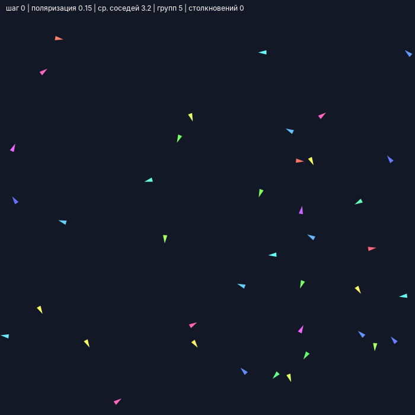
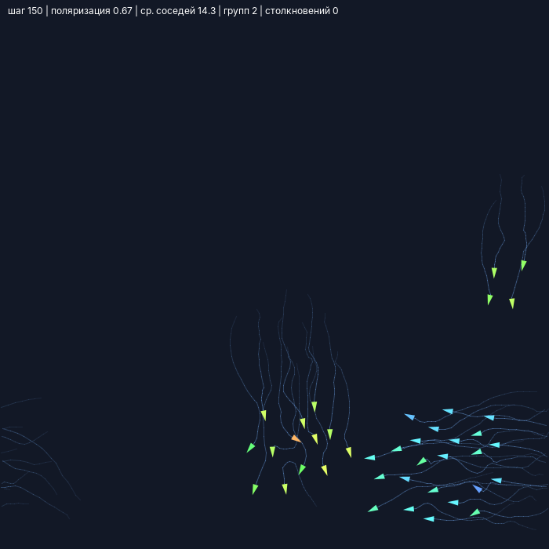
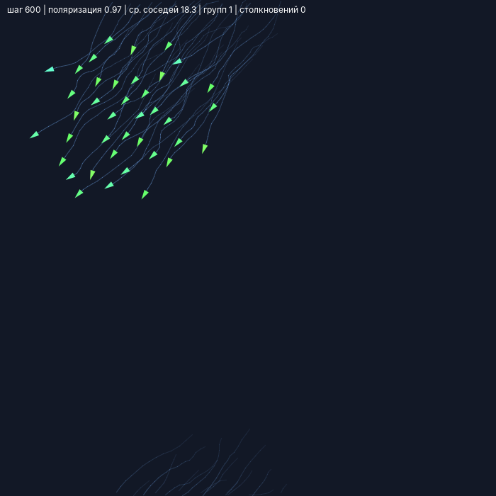
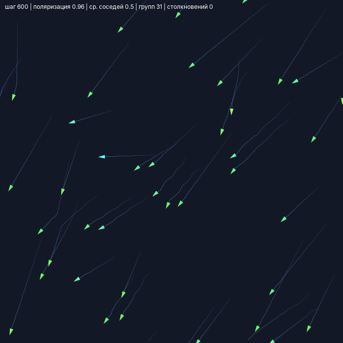
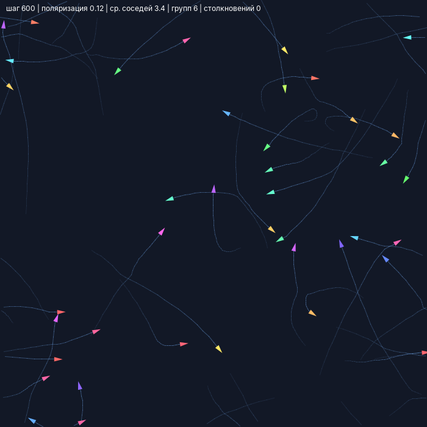

# Лабораторная работа: моделирование коллективного поведения агентов

**Вариант №1:** моделирование движения стаи птиц в 2D-пространстве
**Выполнил:** [ФИО студента], группа [номер группы]
**Дата выполнения:** 22.10.2026

## 1. Цель работы

Научиться моделировать координированное движение агентов правилами Крейга Рейнольдса (Boids): центрирование, выравнивание, разделение. Исследовать, как радиус взаимодействия и веса правил влияют на скоординированность стаи.

## 2. Описание модели

- **Среда:** плоскость 100×100. Границы: циклические (по умолчанию) или отражение.
- **Агенты:** 40 птиц. У каждой позиция (x, y) и скорость (vx, vy). Начальные позиции и направления случайны, модуль скорости от 0,5 до 2,0. Фиксированный seed=42 делает эксперименты воспроизводимыми.
- **Параметры (`Params`):** радиус взаимодействия R=15, радиус разделения 4, веса wCoh=0,01, wAli=0,05, wSep=0,1, максимальная скорость 2,0, минимальная 0,5.
- **Допущения:** птицы — материальные точки, обзор круговой, шаг времени равен 1, ограничивается итоговая скорость.

## 3. Описание алгоритма

На каждом шаге для каждой птицы находятся соседи в радиусе R (при циклической границе расстояние считается по кратчайшему пути). Считаются три вектора:

1. **Центрирование:** вектор к центру масс соседей × wCoh.
2. **Выравнивание:** (средняя скорость соседей − своя скорость) × wAli.
3. **Разделение:** сумма отталкиваний от соседей ближе радиуса разделения × wSep.

Новая скорость = старая + сумма трёх векторов, затем модуль скорости ограничивается диапазоном [minSpeed, maxSpeed]. Обновление синхронное: сначала считаются новые скорости всех птиц, потом все смещаются одновременно. Затем применяется обработка границ.

**Метрики:** поляризация (1 — все летят в одну сторону, около 0 — хаос), среднее число соседей, среднее расстояние до ближайшего соседа, число групп (связные компоненты графа «расстояние < R»), число пар ближе 1 единицы (условные столкновения).

## 4. Реализация

Java (JDK 11+), внешние библиотеки не нужны (только Swing/AWT). Весь код в `Boids.java`.

- `Params` — все параметры среды, агентов и правил.
- `Sim` — модель: массивы координат и скоростей, `step()`, метрики.
- `View` — отрисовка в Swing: птицы-треугольники, цвет по направлению, следы траекторий, метрики в верхней строке.
- `runGui()` — окно с ползунками (радиусы, веса, макс. скорость, число птиц), переключателем границ, паузой, сбросом и следами.
- `runExperiments()` — режим без окна, печатает таблицу экспериментов.

**Запуск:**

```
javac -encoding UTF-8 Boids.java
java Boids                 # окно с анимацией
java Boids --experiments   # таблица экспериментов
```

## 5. Результаты визуализации

Цвет стрелки — направление движения, тонкие линии — траектории за последние 25 шагов.


*Рис. 1. Начальное состояние: случайные позиции и направления.*


*Рис. 2. Шаг 150, базовые параметры: птицы собираются в группу.*


*Рис. 3. Шаг 600, базовые параметры: единая стая, поляризация 0,97.*


*Рис. 4. R=5: птицы почти не видят друг друга, стая не образуется.*


*Рис. 5. wAli=0: направления хаотичны, стая распадается на группы.*


*Рис. 6. wSep=0: птицы сливаются в одну точку.*

## 6. Эксперименты

40 птиц, 600 шагов, seed=42. Показатели усреднены по последним 200 шагам. Границы циклические, если не указано иное.

| Эксперимент | R | wCoh | wAli | wSep | Поляризация | Ср. соседей | Ср. расст. до ближ. | Групп | Столкн. (пар/шаг) |
|---|---|---|---|---|---|---|---|---|---|
| Базовый (R=15; 0.01/0.05/0.1) | 15 | 0.01 | 0.05 | 0.10 | 0.96 | 19.2 | 3.98 | 1.0 | 0.06 |
| R=5 | 5 | 0.01 | 0.05 | 0.10 | 0.86 | 0.2 | 8.65 | 36.1 | 0.00 |
| R=30 | 30 | 0.01 | 0.05 | 0.10 | 0.95 | 38.9 | 3.21 | 1.0 | 0.98 |
| R=50 | 50 | 0.01 | 0.05 | 0.10 | 0.95 | 39.0 | 3.27 | 1.0 | 0.70 |
| Без центрирования (wCoh=0) | 15 | 0.00 | 0.05 | 0.10 | 1.00 | 5.0 | 7.39 | 1.0 | 0.00 |
| Сильное центрирование (wCoh=0.05) | 15 | 0.05 | 0.05 | 0.10 | 0.84 | 34.3 | 1.96 | 1.0 | 4.05 |
| Без выравнивания (wAli=0) | 15 | 0.01 | 0.00 | 0.10 | 0.10 | 3.5 | 7.20 | 6.1 | 0.20 |
| Сильное выравнивание (wAli=0.2) | 15 | 0.01 | 0.20 | 0.10 | 0.98 | 19.7 | 4.08 | 2.0 | 0.00 |
| Без разделения (wSep=0) | 15 | 0.01 | 0.05 | 0.00 | 1.00 | 39.0 | 0.00 | 1.0 | 780.00 |
| Сильное разделение (wSep=0.4) | 15 | 0.01 | 0.05 | 0.40 | 0.11 | 3.7 | 7.56 | 5.1 | 0.00 |
| Отражение от границ | 15 | 0.01 | 0.05 | 0.10 | 0.77 | 18.5 | 3.80 | 1.0 | 0.43 |

**Наблюдения:**

- **Базовые параметры:** одна устойчивая стая, поляризация 0,96, столкновений почти нет.
- **R=5:** у птицы в среднем 0,2 соседа, стая не образуется (около 36 групп). **R=30 и R=50:** стая одна, но чаще сближения (0,98 и 0,70 пар за шаг).
- **wCoh=0:** направления выровнены (поляризация 1,0), но птицы не сближаются (расстояние до ближайшего 7,4). **wCoh=0,05:** очень плотная стая (1,96), но много столкновений (4,05) и ниже поляризация (0,84).
- **wAli=0:** поляризация 0,10, движение несогласованное, около 6 групп. **wAli=0,2:** поляризация 0,98, столкновений нет.
- **wSep=0:** птицы сливаются в точку (расстояние 0, в среднем 780 пар «в столкновении»). **wSep=0,4:** птицы отталкиваются, поляризация 0,11, стая рассеивается (около 5 групп).
- **Отражение от границ:** стая единая, но поляризация ниже (0,77): у стен птицы разворачиваются и сбивают общее направление.

## 7. Выводы

- Скоординированное движение возникает из трёх простых локальных правил без центрального управления.
- Радиус взаимодействия определяет, образуется ли стая: при малом птицы не видят соседей, при большом стая единая, но плотнее и опаснее по столкновениям.
- Выравнивание отвечает за согласованность направления, центрирование — за сплочённость, разделение — за отсутствие столкновений. Нарушение баланса любого правила даёт характерный сбой: хаос, рассеивание или слипание.
- Значения 0,01 / 0,05 / 0,1 дают устойчивую стаю с высокой поляризацией и почти без столкновений.
- Циклические границы лучше сохраняют упорядоченное движение, чем отражение.